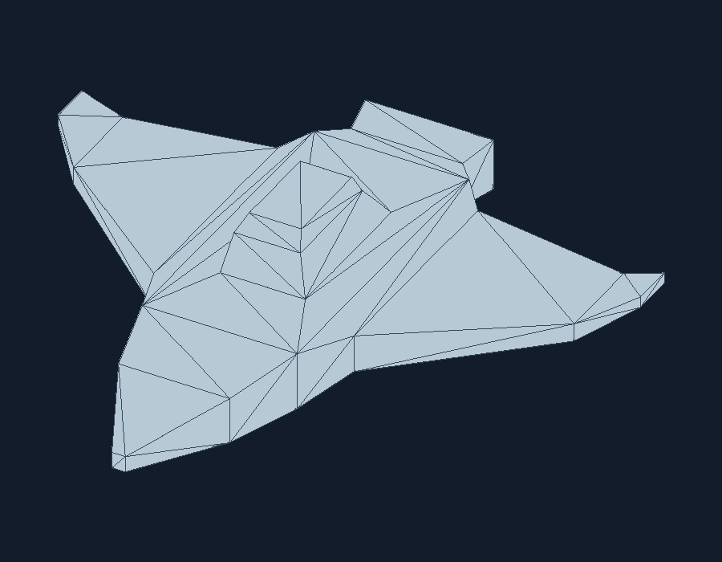

# Lab 4: nave OBJ con rasterizacion de triangulos

El programa carga `Lab3.obj` desde el filesystem, recorre sus caras y recupera los
tres vertices de cada triangulo mediante sus indices. Rasteriza los triangulos
en un framebuffer propio de 900 × 700 pixeles con buffer de profundidad. Usa
una proyeccion ortografica, calcula los limites del modelo para centrarlo y
guarda exactamente los pixeles presentados en la ventana.



## Requisitos y ejecucion

- Rust con Cargo (edicion 2024).
- Windows, Linux o macOS con un escritorio disponible para abrir la ventana.

Desde la raiz del repositorio:

```sh
cargo run --release
```

La ventana permanece abierta hasta cerrarla o pulsar `Esc`. Al iniciar se genera
`nave.png` desde el mismo framebuffer mostrado en pantalla. Si solo se necesita
el archivo PNG, sin abrir una ventana:

```sh
cargo run --release -- --export-only
```

Para elegir otro modelo OBJ y la ruta del PNG:

```sh
cargo run --release -- --obj ruta/al/modelo.obj --output resultado.png
```

Las rutas relativas se resuelven desde el directorio donde se ejecuta Cargo.
El OBJ debe incluir vertices `v` y caras `f`; se aceptan referencias `v`,
`v/vt`, `v//vn` y `v/vt/vn`, indices positivos o negativos, y caras de mas de
tres vertices (trianguladas mediante recorte de orejas, incluso si son concavas).
Las coordenadas de textura, normales y materiales no se usan en este ejercicio.

## Verificacion

```sh
cargo fmt --all -- --check
cargo check
cargo test
```

`minifb` solo presenta el arreglo de pixeles; el dibujo y la prueba de
profundidad se realizan en `src/triangle.rs` y `src/framebuffer.rs`.
`image` solo codifica el framebuffer como PNG. El modelo se carga una vez antes
de abrir la ventana; el ciclo de la ventana presenta la imagen ya rasterizada.
